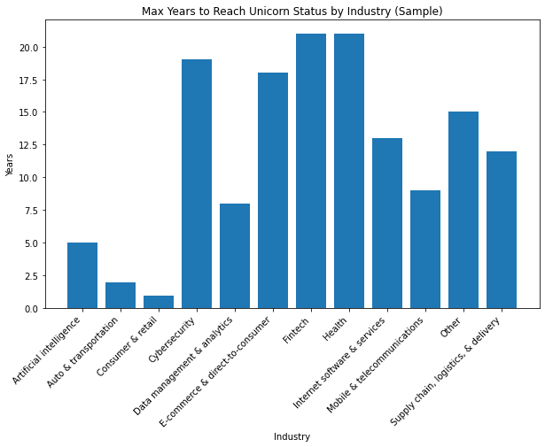
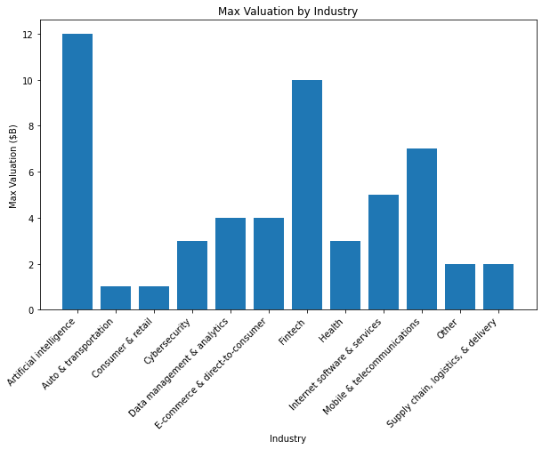

# 📊 Bản Tóm tắt Điều hành: Phân tích Xu hướng & Tiềm năng Doanh nghiệp Kỳ lân (Unicorn Companies)

**Người lập:** Data Professional  
**Đơn vị:** Investment Analytics Team  
**Đối tượng báo cáo:** Ban Lãnh đạo Quỹ Đầu tư Mạo hiểm (Investing Firm Leadership)  
**Tập dữ liệu:** `Unicorn_Companies.csv` (1,074 doanh nghiệp trên toàn cầu)  

---

## 1. Bối cảnh & Mục tiêu Bài toán

Quỹ đầu tư đang tìm kiếm các cơ hội đầu tư chiến lược vào các doanh nghiệp công nghệ tiềm năng. Nhóm phân tích dữ liệu được giao nhiệm vụ thực hiện **Khám phá Dữ liệu Chuyên sâu (EDA)** trên tập dữ liệu các công ty "kỳ lân" (*Unicorns* - các startup được định giá từ 1 tỷ USD trở lên) nhằm:
1. Xác định thời gian trung bình và tối đa để một doanh nghiệp bứt phá thành kỳ lân theo từng ngành nghề.
2. Đánh giá tiềm năng trần định giá (*Valuation ceiling*) của các lĩnh vực khác nhau.
3. Đề xuất chiến lược phân bổ danh mục đầu tư phù hợp giữa tốc độ sinh lời và giá trị vốn hóa.

---

## 2. Tổng quan Dữ liệu & Quy trình Tiền xử lý

* **Quy mô tập dữ liệu:** 1,074 dòng (đại diện cho 1,074 kỳ lân toàn cầu) và 10 cột thuộc tính:
  * Thông tin cơ bản: `Company`, `Industry`, `City`, `Country/Region`, `Continent`.
  * Thông tin tài chính & thời gian: `Valuation`, `Date Joined`, `Year Founded`, `Funding`, `Select Investors`.
* **Tiền xử lý & Kỹ thuật chuyển đổi:**
  * Cột `Date Joined` đã được chuẩn hóa từ kiểu chuỗi (`object`) sang `datetime64[ns]` bằng `pd.to_datetime()`.
  * Trích xuất năm gia nhập `Year Joined` qua `.dt.year` để tạo biến đo lường thời gian:  
    $$\text{Years To Unicorn} = \text{Year Joined} - \text{Year Founded}$$
  * Làm sạch cột định giá `Valuation`: loại bỏ ký hiệu tiền tệ `$` và hậu tố `B`, chuyển đổi thành biến định lượng `Valuation_Billions` (`float`) phục vụ tổng hợp dữ liệu.

---

## 3. Các Phát hiện Cốt lõi (Key Findings)

### 3.1. Thời gian đạt vị thế Kỳ lân theo Ngành (Time-to-Unicorn)
Phân tích trên mẫu đại diện 50 doanh nghiệp ghi nhận sự phân hóa rõ rệt về chu kỳ tăng trưởng giữa các mô hình kinh doanh:
* **Nhóm bứt phá thần tốc:**
  * **Consumer & Retail:** 1 năm.
  * **Auto & Transportation:** 2 năm.
  * **Artificial Intelligence (AI):** 5 năm.
* **Nhóm chu kỳ tích lũy dài hạn:**
  * **Fintech** và **Health:** Đạt mức tối đa lên tới **21 năm**.
  * **Cybersecurity:** 19 năm.
  * **E-commerce & Direct-to-Consumer:** 18 năm.

> **Nhận định chuyên môn:** Các ngành đòi hỏi sự kiểm duyệt pháp lý nghiêm ngặt, bằng sáng chế hoặc hạ tầng bảo mật phức tạp (như Tài chính, Y tế) đòi hỏi nguồn vốn dài hạn và lộ trình phát triển bền bỉ trước khi đạt mức định giá 1 tỷ USD. Ngược lại, các công ty AI và thương mại tiêu dùng có thể mở rộng quy mô người dùng rất nhanh.

---

### 3.2. Trần Định giá theo Ngành (Max Valuation by Industry)
Khi xem xét mức định giá cao nhất đạt được theo ngành:
* **Artificial Intelligence** dẫn đầu tuyệt đối với định giá đỉnh lên tới **12 tỷ USD** (trong mẫu phân tích).
* **Fintech** xếp vị trí thứ hai với định giá cao nhất đạt **10 tỷ USD**.
* Các ngành công nghệ viễn thông và phần mềm Internet: **Mobile & Telecommunications** ($7B), **Internet Software & Services** ($5B).
* Các nhóm ngành truyền thống trong mẫu (Auto, Consumer & Retail) duy trì mức định giá đỉnh khiêm tốn hơn ($1B).

> **Nhận định chuyên môn:** Mặc dù AI mất ít thời gian hơn để trở thành kỳ lân so với Fintech, nhưng cả hai đều là những "thỏi nam châm" thu hút dòng vốn lớn nhất và đem lại định giá vốn hóa bứt phá vượt trội.

---

## 4. Khuyến nghị Chiến lược cho Quỹ Đầu tư (Strategic Recommendations)

1. **Phân bổ Danh mục Đầu tư 2 Tốc độ (Two-Speed Portfolio Strategy):**
   * **Quỹ Tăng trưởng Thần tốc (Momentum Fund):** Rót vốn ưu tiên vào các startup **Artificial Intelligence** và **Internet Software**. Đây là các ngành có thời gian chuyển đổi thành kỳ lân ngắn (3 - 5 năm) với tỷ suất lợi nhuận và định giá kỳ vọng rất cao.
   * **Quỹ Giá trị Bền vững (Patient Capital Fund):** Duy trì tỷ trọng chiến lược vào **Fintech** và **HealthTech**. Mặc dù thời gian ươm mầm dài hơn (10 - 20 năm), rào cản gia nhập cao tạo nên lợi thế kinh tế hào thành (*moat*) vững chắc và mức định giá trần cực kỳ hấp dẫn ($10B+).

2. **Tiêu chí Thẩm định Công ty:**
   * Đối với các startup ngành y tế/tài chính, đánh giá cao kinh nghiệm pháp lý và quan hệ đối tác tổ chức của đội ngũ sáng lập hơn là chỉ nhìn vào tốc độ tăng trưởng người dùng ngắn hạn.
   * Đối với startup AI, tập trung vào khả năng thương mại hóa và ứng dụng thực tiễn của mô hình để đảm bảo giữ vững trần định giá.

---

## 5. Hạn chế & Các bước Phân tích Tiếp theo (Next Steps)

1. **Mở rộng Phân tích Toàn diện:** Tiến hành áp dụng toàn bộ quy trình EDA trên toàn bộ 1,074 doanh nghiệp trong tập dữ liệu (thay vì chỉ lấy mẫu 50).
2. **Phân tích Hiệu quả Vốn (Capital Efficiency):** Kết hợp cột `Funding` để tính chỉ số:
   $$\text{Capital Efficiency Ratio} = \frac{\text{Valuation}}{\text{Total Funding}}$$
   nhằm tìm ra ngành tạo ra nhiều giá trị nhất trên mỗi đồng vốn đầu tư.
3. **Bản đồ Địa lý & Mạng lưới Nhà đầu tư:** Khám phá vai trò của vị trí địa lý (`Country/Region`, `City`) và mạng lưới các nhà đầu tư lớn (`Select Investors` như Sequoia Capital, Tiger Global) trong việc thúc đẩy startup cán mốc kỳ lân.
